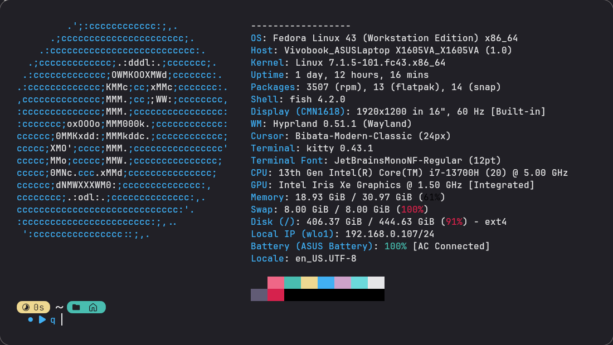

<div align="center">

# dotfiles

**Hyprland rice on Fedora 43** — [end-4/dots-hyprland](https://github.com/end-4/dots-hyprland) (*illogical-impulse*) · [Quickshell](https://quickshell.org/) · [Matugen](https://github.com/InioX/matugen)



</div>

---

## Stack

| | |
|---|---|
| **OS** | Fedora Linux 43 (Workstation) |
| **WM** | Hyprland 0.51.1 |
| **Shell UI** | Quickshell (illogical-impulse) |
| **Theme** | Matugen — Material You, generated from wallpaper |
| **Terminal** | kitty / foot |
| **Shell** | fish + starship |
| **CPU / GPU** | Intel Core i7-13700H · Intel Iris Xe |

## Install

### Fedora — one shot

Enables the COPRs, installs every package, deploys the dotfiles:

```bash
git clone https://github.com/abdullaabdullazade/dotfiles ~/dotfiles
cd ~/dotfiles
./fedora-install.sh
```

> COPRs: `solopasha/hyprland` · `errornointernet/quickshell` · `atim/starship`

### Manual / other distro

```bash
cd ~/dotfiles
sudo dnf install $(grep -v '^#' packages.txt)   # or your package manager
./install.sh --dry-run                           # preview, changes nothing
./install.sh                                      # deploy
```

`install.sh` symlinks each entry into `~/.config` and `~`. Anything already there
is moved to `~/.dotfiles-backup/<timestamp>/` first — nothing is lost.
Use `--copy` to copy instead of symlink.

## What's inside

| Path | Tool |
|------|------|
| `config/hypr/` | Hyprland — compositor, hypridle, hyprlock, hyprpaper, monitors, workspaces |
| `config/quickshell/` | Quickshell — bar, widgets, launcher, OSD (illogical-impulse `ii`) |
| `config/illogical-impulse/` | shell `config.json` + translations |
| `config/matugen/` | Matugen colour-generation templates (feeds GTK / Qt / kitty …) |
| `config/kitty/` · `config/foot/` | terminals |
| `config/fish/` | `config.fish`, `conf.d/`, `functions/` |
| `config/fuzzel/` · `config/wlogout/` | launcher · logout menu |
| `config/cava/` · `config/btop/` · `config/mpv/` | audio visualiser · monitor · media |
| `config/gtk-*` `qt5ct` `qt6ct` `Kvantum` `kdeglobals` `fontconfig` | GTK + Qt theming |
| `config/starship.toml` | prompt |
| `home/` | `.bashrc` `.bash_profile` `.zshrc` `.gitconfig` |
| `wallpapers/` | copied to `~/Pictures/Wallpapers` |

## Tools

```bash
./sysinfo.sh        # host, hardware, and which tracked config each tool uses
./install.sh --help
```

## Will someone get exactly my setup?

Configs: yes. Pixel-identical: mostly, with caveats.

- **Wallpaper included** (`wallpapers/`). Matugen regenerates colours from it, so
  the theme matches.
- **Paths are absolute** (`/home/abdullaxows/...`). Same username → just works.
  Different username → run `./install.sh --copy`, which rewrites them to your `$HOME`.
- **Not included:** font / icon / cursor / GTK-theme *packages* — install via your
  package manager if a glyph or icon is missing (`fedora-install.sh` handles the common ones).

## Secrets

No live secrets committed. Sensitive values are replaced with `REPLACE_ME`
(e.g. `LLM_API_KEY` in `home/.bashrc`) — set the real value locally after install.
`.env`, keys, and `fish_variables` are gitignored.

## Credits

[end-4/dots-hyprland](https://github.com/end-4/dots-hyprland) · [Quickshell](https://quickshell.org/) · [Matugen](https://github.com/InioX/matugen) · [Hyprland](https://hyprland.org/)
